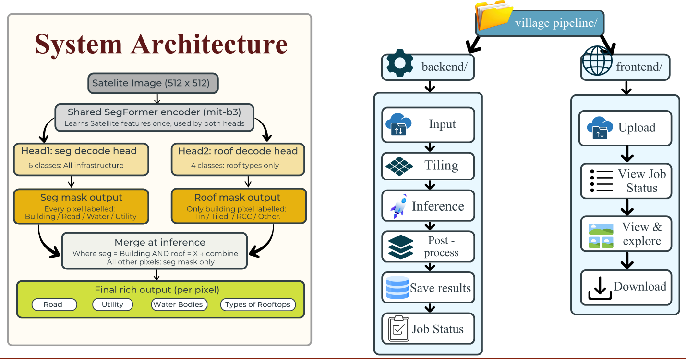
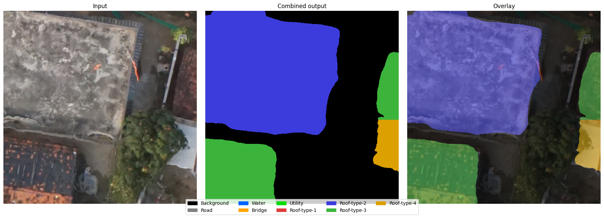
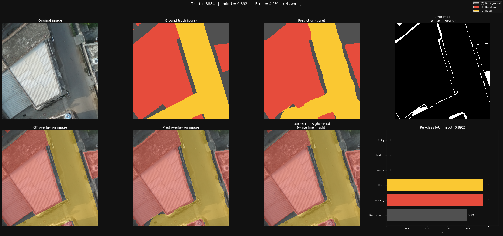
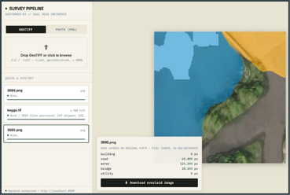
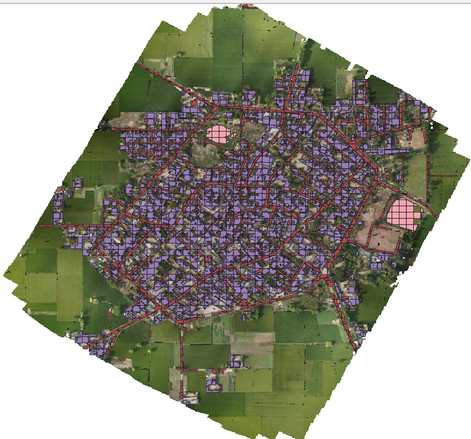

<div align="center">

# Dual-Head SegFormer for Drone Orthophoto Feature Extraction

### Infrastructure segmentation and rooftop classification for village-scale geospatial mapping

**PyTorch · SegFormer MiT-B3 · Computer Vision · FastAPI · GeoPandas · GeoPackage**

</div>

---

## Overview

High-resolution drone orthophotos contain important village infrastructure such as buildings, roads, water bodies, bridges and utilities. Extracting these features manually can be time-consuming and may lead to inconsistent mapping.

This project explores an automated **dual-head semantic segmentation pipeline** for village-scale orthophoto analysis. It uses a shared SegFormer MiT-B3 encoder with two specialised prediction heads:

- **Infrastructure head:** pixel-wise segmentation of six infrastructure classes.
- **Rooftop head:** classification of four roof types, trained only on building pixels.

At inference, the predictions are combined into a richer feature map. For georeferenced imagery, extracted features can be converted into GIS-ready vector layers and exported as a GeoPackage (`.gpkg`).

The project was developed for the **National AI/ML Hackathon – Geospatial Intelligence Challenge**, under Problem Statement PS-1, focused on AI-based feature extraction from drone orthophotos for the SVAMITVA scheme.

> **Project stage:** Working prototype. The repository contains training and inference components alongside a local web application. It is not presented as a production-deployed government system.

---

## System architecture

The system uses a shared SegFormer MiT-B3 encoder and two task-specific heads. The infrastructure head predicts six semantic classes, while the rooftop head predicts roof categories on building regions. Their outputs are combined during inference before geospatial feature extraction.

**Add the original architecture diagram from the project presentation at `assets/architecture.png`.**



---

## Key results

### Baseline vs improved infrastructure segmentation

The project progressed from an initial MiT-B2 baseline to an improved MiT-B3 configuration with revised training settings and loss design.

| Metric | Baseline | Improved |
|---|---:|---:|
| Backbone | MiT-B2 | **MiT-B3** |
| Training epochs | 50 | **65** |
| Validation mIoU | 0.5515 | **0.7182** |
| Validation pixel accuracy | 0.9121 | **0.9292** |

**Validation mIoU improved by 0.1667 absolute points (approximately 30.2% relative improvement).**

### Per-class IoU comparison

| Infrastructure class | MiT-B2 baseline | MiT-B3 improved |
|---|---:|---:|
| Background | 0.8671 | **0.8896** |
| Building | 0.8409 | **0.8724** |
| Road | 0.6960 | **0.7384** |
| Water body | 0.8098 | **0.8797** |
| Bridge | 0.0000 | **0.7620** |
| Utility | 0.0948 | **0.1674** |

The bridge class improved from an IoU of 0.0000 to 0.7620. Utility detection also improved, although it remains the most challenging class.

> **Experiment interpretation:** The baseline-to-improved comparison changes multiple factors together, including the backbone, training duration, augmentation and loss configuration. It demonstrates the improvement achieved by the overall revised training setup; it does not isolate the contribution of any single change.

The reported results above are for the **six-class infrastructure segmentation head**. A separate final rooftop-head IoU or accuracy is not reported here and should not be inferred from these metrics.

---

## Architecture details

### Head 1 — Infrastructure segmentation

The infrastructure head predicts six pixel classes:

| Class ID | Class |
|---:|---|
| 0 | Background |
| 1 | Building |
| 2 | Road |
| 3 | Water |
| 4 | Bridge |
| 5 | Utility |

### Head 2 — Rooftop classification

The rooftop head predicts four roof categories:

- RCC
- Tin
- Tiled
- Other

The rooftop head is trained specifically on building pixels. Its masked loss prevents non-building pixels from contributing to roof-class learning. In the documented training implementation, the infrastructure checkpoint is loaded and the encoder and segmentation head are frozen while the rooftop head is trained.

### Why a dual-head approach?

Infrastructure segmentation focuses on spatial structure, object boundaries and context. Rooftop classification focuses on material and texture within building regions. Separating these objectives allows the system to represent infrastructure and roof categories without forcing them into one shared label space.

---

## Dataset and preparation

The project uses ministry-provided drone orthophotos and corresponding geospatial annotations for village feature extraction.

The documented infrastructure dataset preparation includes:

1. Aligning orthophotos and vector annotations in **EPSG:32643 (UTM)**.
2. Tiling imagery into **512 × 512** patches.
3. Rasterising vector annotations to create pixel-level infrastructure masks.
4. Creating a separate roof-mask dataset from building polygons and roof-type attributes.
5. Computing class frequencies and inverse-frequency pixel weights.
6. Generating boundary weight maps to support edge learning.

### Documented infrastructure split

| Split | Tiles | Share |
|---|---:|---:|
| Training | 6,862 | 80% |
| Validation | 858 | 10% |
| Test | 858 | 10% |
| **Total** | **8,578** | **100%** |

The project presentation describes approximately 9,000 ministry-provided drone images/tiles. The table above gives the more specific documented infrastructure split.

**Data availability:** Source imagery and annotations are not bundled in this repository. Use only datasets you are authorised to access and share. Do not commit restricted ministry-provided imagery, private village data or large raw datasets.

---

## Training methodology

### Infrastructure head

The improved training configuration documented in the project includes:

- **Backbone:** pretrained `nvidia/mit-b3`
- **Input image size:** 512 × 512
- **Crop size:** 448 × 448
- **Epochs:** 65
- **Batch size:** 8
- **Gradient accumulation:** 2 steps (effective batch size 16)
- **Optimizer:** AdamW
- **Learning rate:** 1.5e-4
- **Weight decay:** 0.01
- **Mixed precision:** enabled where supported

### Class imbalance and boundary handling

The improved training setup combines:

- Focal loss, Dice loss and boundary-weighted loss.
- Inverse-frequency class weighting.
- Copy-paste augmentation to increase representation of rare classes.
- Geometric and photometric augmentation.
- Boundary-weight-map pre-computation and caching.
- Boundary-loss warm-up, allowing the model to learn broad regions before stronger edge refinement.

The improved configuration uses focal, Dice and boundary loss weights of 0.5, 0.4 and 0.1 respectively, with boundary loss activated after the warm-up period.

### Rooftop head

The documented rooftop workflow:

1. Loads the trained infrastructure SegFormer checkpoint.
2. Reuses the shared encoder and infrastructure segmentation head.
3. Adds a lightweight rooftop prediction head.
4. Freezes the encoder and infrastructure head during the documented rooftop-head training stage.
5. Uses masked cross-entropy so only labelled building pixels contribute to roof-type learning.

The repository's rooftop training file should be consulted for exact checkpoint paths and configuration. No rooftop performance metric is claimed here because a verified final value was not supplied.

---


## Inference and geospatial output

The application supports georeferenced GeoTIFF input and ordinary image input, enabling automated infrastructure extraction from drone orthophotos.

### 1. Input — Drone Orthophoto

The workflow begins with a high-resolution drone orthophoto of the mapped village.



### 2. GeoTIFF inference workflow

1. Upload a GeoTIFF through the browser.
2. Split the orthophoto into tiles.
3. Run model inference tile by tile.
4. Extract vector features from predicted masks.
5. Reproject geometries as needed for area calculation.
6. Write GIS layers to a **GeoPackage (`.gpkg`)**.
7. Explore the results on the web map or open the GeoPackage in QGIS.

### 3. Infrastructure segmentation output

The infrastructure head generates pixel-level predictions for buildings, roads, water bodies, bridges and utilities.



The documented output layers include:

- Buildings
- Roads
- Water
- Bridges
- Utilities

Feature attributes can include class information, roof type and area (m²), depending on the extracted feature.

### 4. Web application dashboard

The application provides an interface to upload imagery, monitor inference jobs, visualise predictions and access generated outputs.



### 5. GIS output — GeoPackage in QGIS

For georeferenced GeoTIFF inputs, extracted features are exported as GIS-ready GeoPackage (`.gpkg`) layers. These can be opened and further inspected in QGIS.



### PNG/JPG workflow

For a plain image without georeferencing, the application produces a coloured prediction overlay and pixel counts. A GeoPackage is not generated for a non-georeferenced photo.

### Application features

The supplied application documentation describes:

- FastAPI backend.
- Browser-based image upload interface.
- Background job queue and job-status tracking.
- Interactive map with layer toggles.
- Feature inspection and downloadable GeoPackage.
- PNG/JPG prediction overlays.
- Optional local Ollama chatbot using the selected job's prediction context.

**Runtime note:** Job history is held in memory and is cleared when the backend process restarts. The chatbot requires a locally running Ollama service and the configured model (documented default: `gemma3:latest`).


## Technology stack

| Area | Technologies |
|---|---|
| Deep learning | Python, PyTorch, Hugging Face Transformers, SegFormer MiT-B3 |
| Data augmentation | Albumentations |
| Image processing | NumPy, Pillow, OpenCV |
| Geospatial processing | Rasterio, GeoPandas, Shapely |
| API / backend | FastAPI, Uvicorn |
| Frontend | HTML, JavaScript, interactive web map |
| GIS output | GeoPackage (GPKG), QGIS |
| Local assistant | Ollama, Gemma 3 |

---

## Repository guide

The repository includes the following core components (file locations may reflect the current repository layout):

| Component | Purpose |
|---|---|
| Infrastructure training notebook / script | Infrastructure segmentation training, losses, metrics and checkpointing |
| Rooftop training notebook / script | Rooftop-head training and combined prediction visualisation |
| `model.py` | Model construction and checkpoint loading for inference |
| `tiling.py` | Tiling utilities for large orthophotos |
| `inference.py` | Prediction and geospatial feature extraction |
| `main.py` | FastAPI application and API endpoints |
| `jobs.py` | Background job handling and status |
| `index.html` | Browser-based interface |
| `requirements.txt` | Python dependencies |
| `assets/` | Architecture diagram and project screenshots |

Some training files were developed in notebook/Colab workflows and may contain environment-specific paths or shell commands. Review those paths and install steps before attempting a fresh training run.

---

## Running the application

The existing application setup guide describes a backend/frontend layout. The commands below follow that guide; check the actual folder locations in the repository before running them.

### 1. Clone the repository

```bash
git clone https://github.com/Mayank-art-coder/Dual-Head-SegFormer.git
cd Dual-Head-SegFormer
```

### 2. Create and activate a virtual environment

```bash
python -m venv .venv
```

Linux/macOS:

```bash
source .venv/bin/activate
```

Windows PowerShell:

```powershell
.venv\Scripts\Activate.ps1
```

### 3. Install dependencies

Install PyTorch appropriate for your operating system and CUDA setup first. Then install the project's requirements:

```bash
pip install -r requirements.txt
```

If the application has a backend-specific requirements file, run the command from the directory containing that file.

### 4. Add model checkpoints

Place the trained infrastructure and rooftop checkpoints in the configured checkpoint directory. The application setup guide documents these environment variables:

```bash
SEG_CKPT=./checkpoints/best_model.pth
ROOF_CKPT=./checkpoints/best_roof_model.pth
```

Do not commit large checkpoints to Git unless repository size and model/data sharing permissions have been checked. Provide authorised download instructions separately if weights can be shared.

### 5. Start the API

From the directory containing `main.py`:

```bash
uvicorn main:app --host 0.0.0.0 --port 8000
```

Set the checkpoint environment variables in the same shell/session before starting the service.

### 6. Open the frontend

Open the project's `index.html` in a browser, or serve the frontend directory:

```bash
python -m http.server 5173
```

The supplied setup guide describes the frontend connecting to the API on port `8000`. If your local folder layout or API address differs, update the frontend API base configuration accordingly.

### 7. Optional local chatbot

If enabling the local assistant, start Ollama and ensure the configured model is available:

```bash
ollama serve
ollama pull gemma3:latest
```

The chatbot is optional; image inference and GIS export are separate application functions.

---

## Limitations and considerations

- The reported **0.7182 mIoU is a validation result for infrastructure segmentation**, not a claim of equivalent performance on every village or geographic region.
- Utility IoU (0.1674) indicates that rare/small infrastructure remains challenging.
- Rooftop-head performance should be reported separately once a verified evaluation result is available.
- Performance depends on orthophoto resolution, image quality, annotation consistency, geographic variation and similarity between training and inference data.
- The prototype's job history is in-memory and does not persist across backend restarts.
- The local chatbot depends on Ollama and a locally available language model.
- The hackathon presentation includes a proposed future workflow involving accelerated inference, human-in-the-loop review, continual learning and monitoring. These are **proposed extensions**, not features claimed as implemented in the current prototype.

---

## Team and acknowledgement

**Team:** AIML-F-002  
**Institution:** Thakur College of Engineering and Technology

**Project contributors:**
- Mayank Upadhyay
- Rishikesh Saroj
- Tanmay Walunj
- Taran Shetty

Developed for the **National AI/ML Hackathon – Geospatial Intelligence Challenge**, Problem Statement PS-1, powered by the Geospatial Intelligence and Applications Laboratory, IIT Tirupati Navavishkar I-Hub Foundation (IITTNiF), with the Ministry of Panchayati Raj and associated programme partners.

This repository is maintained as a team project. Contributions and individual responsibilities should be described accurately; repository ownership does not imply sole authorship of the work.

---

## References

- [SegFormer: Simple and Efficient Design for Semantic Segmentation with Transformers (NeurIPS 2021)](https://arxiv.org/abs/2105.15203)
- [Official NVIDIA SegFormer implementation](https://github.com/NVlabs/SegFormer)
- [Hugging Face SegFormer documentation](https://huggingface.co/docs/transformers/model_doc/segformer)
- [GeoPandas documentation](https://geopandas.org/)
- [Rasterio documentation](https://rasterio.readthedocs.io/)
- [FastAPI documentation](https://fastapi.tiangolo.com/)

---

<div align="center">

**Dual-Head SegFormer — From drone orthophotos to structured geospatial intelligence.**

</div>
